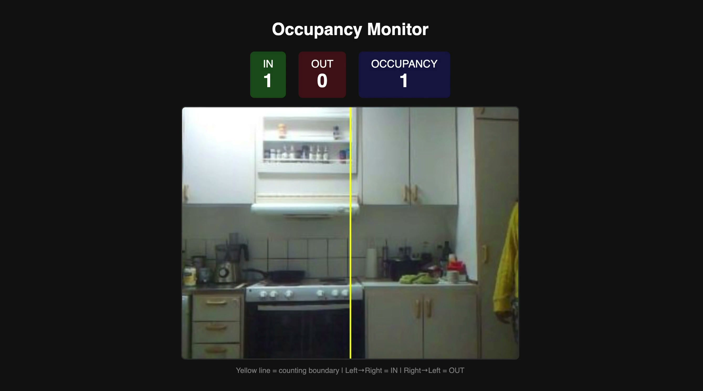

# Pi Camera — Room Occupancy Monitor

Streams video from a Raspberry Pi camera, detects people with YOLOv8, and tracks room occupancy by counting crossings over a configurable line.

## Demo

<div align="center">
  <a href="assets/demo.mp4">
    
    <br/>
    
  </a>
</div>

## Architecture

The **Docker container** runs `app.py` — it runs YOLOv8 person detection, tracks
people with a SORT tracker, counts line crossings, and serves an MJPEG stream and
dashboard at `http://localhost:8080`. It accepts frames from one of two sources,
selected with the `SOURCE` env var:

- **`SOURCE=pi`** (default) — the **Raspberry Pi** runs `pi_camera.py`, which
  captures frames and serves them over TCP on port 9000. `app.py` connects out to
  the Pi and pulls frames.
- **`SOURCE=phone`** — your **phone** is the camera, no Pi required. `app.py`
  serves a capture page at `/phone` over HTTPS; the phone browser grabs the camera
  with `getUserMedia` and pushes ~320×240 JPEG frames (~5 fps) to the `/ingest`
  endpoint. HTTPS (a self-signed cert) is required because mobile browsers only
  allow camera access in a secure context. See
  [Using a phone as the camera](#using-a-phone-as-the-camera-no-pi-needed) below.

Either way the frames land in the same buffer and flow through the identical
detection/counting pipeline.

## Setup

### Pi side

1. Copy the script and install dependencies:

```bash
scp pi_camera.py sandipan-pi@sandipan-pi.local:~/
ssh sandipan-pi@sandipan-pi.local
sudo apt update && sudo apt install -y python3-picamera2 python3-opencv
```

2. Set up auto-start:

```bash
sudo tee /etc/systemd/system/pi-camera.service << 'EOF'
[Unit]
Description=Pi Camera Stream
After=network-online.target
Wants=network-online.target

[Service]
ExecStartPre=/bin/sleep 5
ExecStart=/usr/bin/python3 /home/sandipan-pi/pi_camera.py
Restart=always
RestartSec=3
User=sandipan-pi

[Install]
WantedBy=multi-user.target
EOF

sudo systemctl enable pi-camera
sudo systemctl start pi-camera
```

### Docker side

```bash
docker build -t pi-stream .
docker run --rm -p 8080:8080 -e PI_HOST=sandipan-pi.local pi-stream
```

Open http://localhost:8080.

## Using a phone as the camera (no Pi needed)

If the Pi can't stream, your phone can be the camera instead. The container serves
a capture page; the phone's browser grabs the camera and pushes JPEG frames to
`app.py`, which runs the same YOLO/occupancy pipeline. No app to install.

1. Start the container in phone mode (served over HTTPS so the browser will grant
   camera access). Pass your host's LAN IP as `HOST_IP` so the startup log prints a
   reachable address — the container itself only sees its internal Docker IP:

   ```bash
   docker build -t pi-stream .
   docker run --rm -p 8080:8080 -e SOURCE=phone \
     -e HOST_IP=$(ipconfig getifaddr en0) pi-stream   # macOS Wi-Fi
   ```

   (`HOST_IP` is only for the printed log; the on-screen QR works without it.)

2. Your LAN IP (e.g. `192.168.1.42`) is printed at startup, or get it with
   `ipconfig getifaddr en0`.

3. On the computer, open the dashboard at **https://<computer-ip>:8080/** (accept
   the self-signed cert warning: "Advanced" → "Proceed"). It shows a **QR code and
   join link** for the phone.

4. On the phone (same Wi-Fi network), **scan the QR code** — or open
   `https://<computer-ip>:8080/phone` directly. Accept the cert warning, tap
   **Start**, and allow camera access. Use **Flip camera** to switch front/rear.

   Live video, detection boxes, and IN/OUT/occupancy on the dashboard work exactly
   as with the Pi.

   > Open the dashboard at the machine's LAN IP (not `localhost`) so the QR points
   > to an address the phone can reach. The QR is built from whatever host you used
   > to load the dashboard.

Notes:
- Both devices must be on the same network.
- `SOURCE=phone` serves HTTPS and defaults `ROTATE_180=0`. Counting-line and
  detection flags below all still apply.
- The phone sends ~320×240 frames at ~5 fps to match the Pi's bandwidth.

### Run edited code without rebuilding

After editing `app.py`, you don't need to rebuild the image. Mount your local
`app.py` into the existing container and install the two extra deps on start:

```bash
docker run --rm -p 8080:8080 -e SOURCE=phone \
  -e HOST_IP=$(ipconfig getifaddr en0) \
  -v "$PWD/app.py:/app/app.py" \
  pi-stream \
  sh -c "pip install --quiet qrcode cryptography && python app.py"
```

The `pip install` re-runs each start (a few seconds — not a torch download). Once
the code is stable, bake the deps in permanently with a one-time
`docker build -t pi-stream .`.

To stop the container (and free port 8080 if a rerun complains it's already
allocated):

```bash
docker ps --filter publish=8080 -q | xargs -r docker stop
```

## Configuration

All flags are environment variables passed to `docker run` with `-e`:

| Flag | Default | Description |
|------|---------|-------------|
### Connection

| Flag | Default | Description |
|------|---------|-------------|
| `SOURCE` | `pi` | Frame source: `pi` pulls from the Raspberry Pi over TCP; `phone` serves an HTTPS capture page at `/phone` and ingests frames pushed from a phone browser |
| `PI_HOST` | `sandipan-pi.local` | Hostname or IP of the Raspberry Pi (used when `SOURCE=pi`) |
| `PI_PORT` | `9000` | Port the Pi camera serves on (used when `SOURCE=pi`) |

### Image

| Flag | Default | Description |
|------|---------|-------------|
| `ROTATE_180` | `1` | Rotate image 180 degrees (`1` = on, `0` = off). Use when camera is mounted upside down |

### Counting line

A yellow line divides the frame. When a tracked person's centroid crosses the line, the system counts it as IN or OUT depending on direction.

| Flag | Default | Description |
|------|---------|-------------|
| `COUNT_AXIS` | `x` | Which axis the line crosses: `x` = vertical line (left/right movement), `y` = horizontal line (top/bottom movement) |
| `LINE_POS` | `0.5` | Position of counting line as fraction of frame (0.0 to 1.0). `0.5` = center, `0.3` = 30% from left/top |
| `REVERSE_DIRECTION` | `0` | Set to `1` to swap IN and OUT, so Right → Left (or Bottom → Top) counts as IN |

- **Left → Right** (or Top → Bottom) = **IN** (OUT when `REVERSE_DIRECTION=1`)
- **Right → Left** (or Bottom → Top) = **OUT** (IN when `REVERSE_DIRECTION=1`)
- **Occupancy** = IN − OUT (floored at 0)

### Detection and tracking

YOLOv8n runs person detection on each frame. A SORT tracker (Kalman filter + Hungarian algorithm) assigns stable IDs to detected people and predicts their motion between frames. This handles fast movement and low fps (2-5 fps) much better than simple centroid matching.

**How it works:**

1. YOLO detects person bounding boxes each frame
2. Kalman filter predicts where each tracked person will be based on their velocity
3. Predicted boxes are matched to new detections using IoU (box overlap) via the Hungarian algorithm
4. Crossings are counted frame-by-frame, plus a safety net on disappearance: if a person was first seen on one side of the line and last seen on the other, the crossing is counted even if no single frame captured the exact moment

| Flag | Default | Description |
|------|---------|-------------|
| `MIN_CONFIDENCE` | `0.45` | Minimum YOLO confidence to count a detection as a person. Lower catches more (children, partial views) but risks false positives from furniture or shadows. Higher is stricter but may miss small or partially visible people |
| `IOU_THRESHOLD` | `0.2` | Minimum bounding box overlap to match a detection to an existing track. Lower is more permissive (keeps IDs through occlusion), higher is stricter (avoids wrong matches) |
| `MAX_AGE` | `15` | Frames a track survives without detection before being removed. At 2-5 fps, 15 frames ≈ 3-7 seconds. Raise if people briefly leave the frame and return |
| `DETECT_EVERY` | `1` | Run YOLO every N frames. At 2-5 fps from the Pi, keep at `1`. On faster cameras, `2` or `3` halves/thirds the CPU load by reusing bounding boxes between detections |

**Tuning guide:**

- Too many ghost IDs appearing → raise `MIN_CONFIDENCE` to `0.55` or `0.6`
- Missing children or crouching people → lower `MIN_CONFIDENCE` to `0.3`
- IDs swapping between nearby people → raise `IOU_THRESHOLD` to `0.3`
- Person loses their ID when briefly occluded → lower `IOU_THRESHOLD` to `0.1` or raise `MAX_AGE` to `25`
- Fast crossings not counted → the disappearance check should catch these automatically

Example with custom settings:

```bash
docker run --rm -p 8080:8080 \
  -e PI_HOST=192.168.1.50 \
  -e ROTATE_180=0 \
  -e COUNT_AXIS=y \
  -e LINE_POS=0.4 \
  -e MIN_CONFIDENCE=0.35 \
  -e IOU_THRESHOLD=0.15 \
  -e MAX_AGE=20 \
  pi-stream
```

## API endpoints

| Endpoint | Method | Description |
|----------|--------|-------------|
| `/` | GET | Dashboard with live video and counters |
| `/stream` | GET | Raw MJPEG stream |
| `/stats` | GET | JSON: `{"timestamp": 1696012345.678, "in": N, "out": N, "occupancy": N}` — timestamp is Unix epoch (seconds since 1970-01-01 UTC, with millisecond precision) |
| `/reset` | POST | Reset all counters to zero |

Reset counters: `curl -X POST http://localhost:8080/reset`

## Updating code

After editing `pi_camera.py`:

```bash
scp pi_camera.py sandipan-pi@sandipan-pi.local:~/
ssh sandipan-pi@sandipan-pi.local "sudo systemctl restart pi-camera"
```

After editing `app.py` (fast — no rebuild):

```bash
docker run --rm -p 8080:8080 -e PI_HOST=sandipan-pi.local \
  -v ~/Desktop/Sandipan/pi-stream/app.py:/app/app.py pi-stream
```

This mounts your local `app.py` into the container. Edit the file, restart the container, changes apply instantly. Only rebuild (`docker build -t pi-stream .`) when you change `requirements.txt` or `Dockerfile`.

## Debugging

### Pi camera not streaming

```bash
ssh sandipan-pi@sandipan-pi.local
sudo systemctl status pi-camera
sudo journalctl -u pi-camera -n 30
```

Common issues:
- `ModuleNotFoundError: picamera2` — run `sudo apt install -y python3-picamera2`
- Camera not detected — check the ribbon cable is seated properly, run `vcgencmd get_camera`

### Docker can't connect to Pi

- Check Pi is reachable: `ping sandipan-pi.local`
- Check Pi is serving: `nc -zv sandipan-pi.local 9000`
- Both devices must be on the same network

### Stream loads but no image

- Docker logs show "Connecting to Pi" but not "Connected" — Pi camera service isn't running
- Docker logs show "Connected" — frames are arriving but may be corrupt; check Pi camera logs

### Wi-Fi issues

The Pi B1+ has no built-in Wi-Fi — it uses a USB Wi-Fi dongle (2.4 GHz only). Config file:

```bash
cat /etc/wpa_supplicant/wpa_supplicant.conf
```

To change network:

```bash
sudo tee /etc/wpa_supplicant/wpa_supplicant.conf << 'EOF'
country=SE
ctrl_interface=DIR=/var/run/wpa_supplicant GROUP=netdev
update_config=1

network={
    ssid="YOUR_SSID"
    psk="YOUR_PASSWORD"
}
EOF
sudo reboot
```
